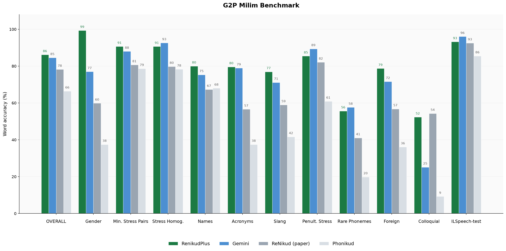

# ReNikud Plus — Hebrew Grapheme-to-Phoneme Inference

Convert unvocalized Hebrew text into IPA for TTS, speech technology, and
spoken-language research. Trained without any benchmark-derived data; on 126k
words of unseen podcast speech it scores 93.5% word accuracy.

## Benchmark



| word accuracy | RenikudPlus | int8 | Gemini | ReNikud | Phonikud |
|---|---:|---:|---:|---:|---:|
| **OVERALL** | **86.2** | 85.9 | 84.6 | 78.2 | 66.4 |
| Gender | **99.3** | 99.3 | 77.0 | 59.9 | 37.5 |
| Min. Stress Pairs | **90.7** | 90.7 | 88.0 | 80.7 | 78.7 |
| Stress Homographs | 90.6 | 90.6 | **92.6** | 79.8 | 78.3 |
| Names | **80.0** | 79.3 | 75.3 | 67.3 | 68.0 |
| Acronyms | **79.6** | 79.0 | 79.0 | 56.6 | 37.5 |
| Slang | **76.9** | 76.9 | 71.2 | 59.0 | 41.7 |
| Penultimate Stress | 85.4 | 86.1 | **89.4** | 82.1 | 60.9 |
| Rare Phonemes | 55.6 | 53.0 | **57.6** | 41.1 | 19.9 |
| Foreign | **78.7** | 78.1 | 71.6 | 56.8 | 36.1 |
| Colloquial | 52.3 | 51.7 | 25.2 | **54.3** | 9.3 |
| ILSpeech-test | 93.2 | 93.1 | **96.0** | 92.5 | 85.5 |

## Install

**From PyPI:**

```console
pip install 'renikud-plus[cpu]'    # CPU inference
pip install 'renikud-plus[gpu]'    # CUDA inference
```

Pick the extra that matches the machine. ONNX Runtime is not a hard dependency
on purpose: `onnxruntime` and `onnxruntime-gpu` are separate distributions that
unpack into the *same* `onnxruntime/` directory, so pip installs both happily
and whichever it writes last wins. If this package depended on the CPU build,
it would silently disable CUDA for anyone who also asked for `onnxruntime-gpu`
— and because pip's install order is topological rather than file order, they
could not fix it by reordering their requirements. Nothing errors; sessions just
quietly run on CPU.

If you already manage ONNX Runtime yourself, plain `pip install renikud-plus`
leaves your build untouched.

**From this repo (no PyPI):**

```console
uv sync
```

Then run the example:

```console
uv run python examples/basic.py
```

The ONNX weights (~310 MB) and the rescoring datastore download automatically
from Hugging Face on first use and are cached locally. No separate
`hf download` step is required.

## Usage

```python
from renikud_onnx import G2P

g2p = G2P()  # downloads notmax123/RenikudPlus model.onnx + datastore.json if needed
print(g2p.phonemize("שלום לכולם"))
# → ʃalˈom lekulˈam
```

Pass a local path if you already have the weights:

```python
g2p = G2P("model.onnx")   # or model_int8.onnx — 4× smaller, ~0.3 pt overall
```

For a gender-conditioned ONNX model, pass `speaker` and `target_speaker` as
`0` (unknown), `1` (male), or `2` (female):

```python
g2p.phonemize("היא רצה", speaker=2, target_speaker=2)
```

### What runs around the model

- **Exact-MAP cascade decode** (default). Consonant, vowel and stress are
  decoded jointly under `E(c,v,s) = log P(c) + log P(v|c) + log P(s|c,v)`, with
  per-letter legality and "stress needs a vowel" as hard constraints, so the
  one-stress-per-word choice can flip the vowel and consonant too. Pass
  `exact_map=False` for the old greedy argmax.
- **Attested-reading rescorer**, on by default whenever `datastore.json` is
  found beside the weights (it is, after the automatic download). A trust gate
  at `tau=0.2` over corpus-attested readings; `datastore=None` switches it off.
- **Force lexicon** — `G2P(..., lexicon={"סבתא": "sˈavta"})` or a TSV path. Off
  unless passed; wins wherever it matches.
- **Hebrew number front end**, from
  [`hebrew-num2words`](https://pypi.org/project/hebrew-num2words/) (installed as
  a dependency). Digits never appear in training text, so they are expanded to
  words first — gender-, construct- and context-aware
  (`"המחיר 1250 שקלים"` → `hameχˈiʁ ʔˈelef matˈajim veχamiʃˈim ʃkalˈim`), with
  clock time, date, year, percent, decimal and identifier readings.
  `number_norm="off"` skips it. Its API is re-exported, so
  `from renikud_onnx import normalize_numbers` still works.
- **Long inputs.** Text past the encoder's 2,046-character window is split on
  sentence, then comma, then word boundaries and decoded window by window; the
  pieces are contiguous, so concatenation is lossless. A `[א-ת]`-in-output
  backstop warns (or raises, `on_hebrew_leak="raise"`) if raw Hebrew survives
  into the IPA.

### Vowelized (pointed) input

Input may carry niqqud or cantillation, in either of two modes.

**`niqqud="strip"` (default).** The marks are dropped before tokenization, so
pointed text decodes exactly like the same text unpointed — and, in particular,
cannot disambiguate anything:

```python
g2p.phonemize("שָׁלוֹם לְכֻּלָּם")  # → ʃalˈom lekulˈam, identical to the bare form
```

**`niqqud="use"`.** The points are read as evidence. Each vowel sign, dagesh qal
and shin/sin dot is pinned into the exact-MAP energy as a hard constraint, so
the model predicts only what the pointing leaves open:

```python
g2p = G2P(niqqud="use")          # or per call: g2p.phonemize(text, niqqud="use")
g2p.phonemize("סֵפֶר")   # sˈefeʁ   book
g2p.phonemize("סַפָּר")   # sˈapaʁ   barber
g2p.phonemize("סָפַר")   # sˈafaʁ   counted
g2p.phonemize("סִפֵּר")   # sˈipeʁ   told
```

All four are `sˈefeʁ` under `"strip"` — the skeleton ספר cannot tell them apart.

Two signs stay ambiguous on purpose and are left to the model: **qamats**, since
qamats qatan (/o/, as in כָּל → `kˈol`) is written with the same sign in most
pointed text, and **shva**, since shva na is /e/ while shva nah is nothing.
Unmarked letters inside a pointed word are read the way pointed text implies —
a bare ו is the consonant (a vowel vav would carry holam or dagesh), a bare י
after hiriq or tsere is a mater, a word-final bare א/ה is silent.

Caveats. The mode needs the exact-MAP decode (it raises with `exact_map=False`).
Niqqud does not mark **stress**, so stress stays the model's own call — and where
the pointing overrules its reading of the skeleton, its stress can still reflect
the reading it preferred (`סַפָּר` → `sˈapaʁ`, not `sapˈaʁ`). A constraint that
would leave a letter with no legal reading at all is dropped rather than
enforced, so partially or sloppily pointed text degrades to the default decode
instead of breaking.

On 24 hand-checked pointed words, `"use"` gets **24/24 vowels and consonants**
right against 13/24 for `"strip"`; including stress, 19/24 against 13/24. On the
seven pointed possessive-suffix words from the field report (`בְּנֹתָיו`,
`צִדְקֹתָיו`, `קֳדָשָׁיו`, …) it matches the reference reading **7/7**.

### Niqqud output

`vocalize` renders the same predictions as pointed Hebrew (niqqud) instead of
IPA — for TTS engines that read niqqud natively but ignore phoneme markup. It
accepts the same `speaker` / `target_speaker` arguments.

```python
print(g2p.vocalize("שלום לכולם"))
# → שַׁלוֹם לֶכּוּלַם
```

Niqqud has no stress mark, so predicted stress is not represented in this output
(it is in `phonemize`). Diacritization is phonetically faithful but not
publication-grade — e.g. shva in clusters is omitted. The IPA-side rescorer and
force lexicon rewrite IPA strings and so do not apply here.


## Citation

```bibtex
@misc{melichov2026renikud,
  title={ReNikud: Audio-Supervised Hebrew Grapheme-to-Phoneme Conversion},
  author={Maxim Melichov and Yakov Kolani and Morris Alper},
  year={2026},
  url={https://arxiv.org/pdf/2606.20179},
}
```
